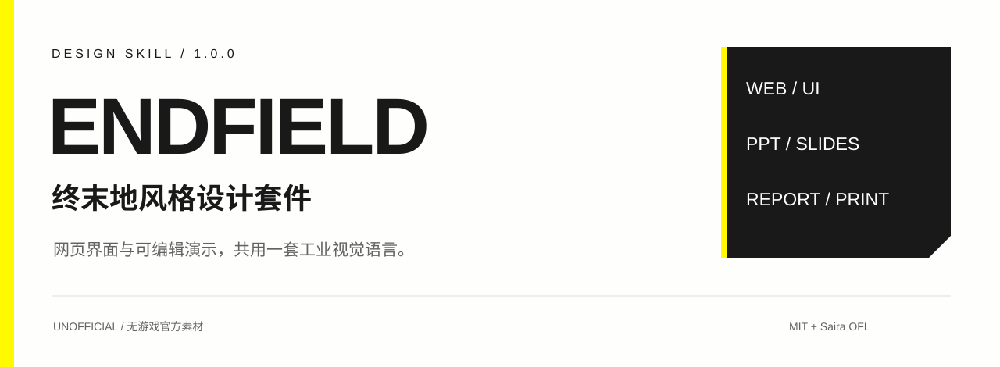
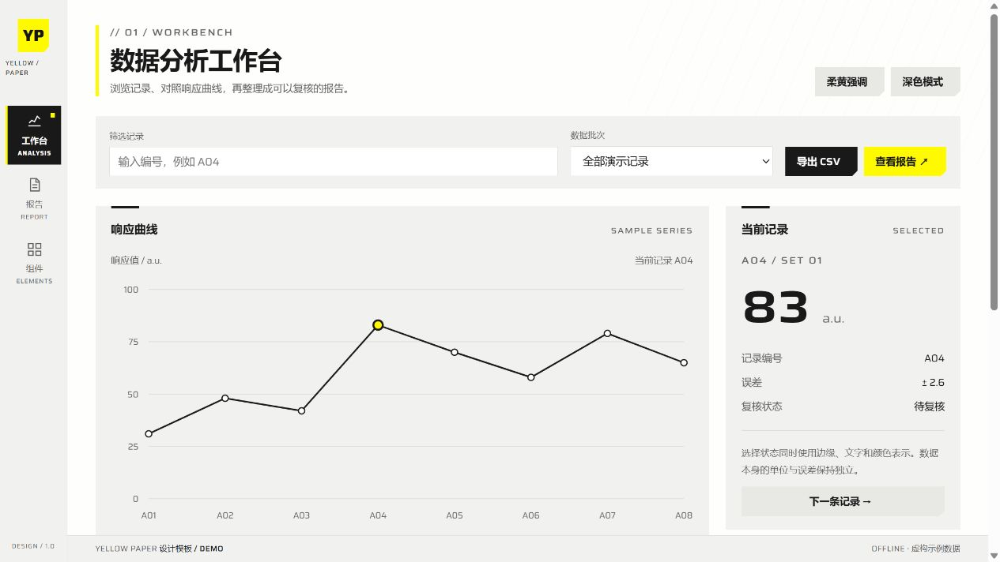
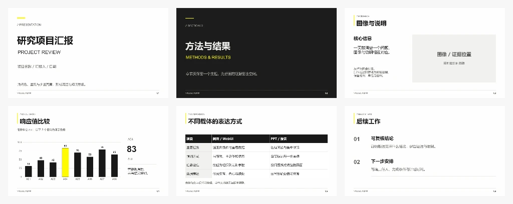

# Endfield Design Kit

**An unofficial Arknights: Endfield-inspired design skill for web interfaces, editable presentations and reports.**

[中文](README.md) · [Skill instructions](skills/endfield-design-kit/SKILL.md) · [PPTX template](skills/endfield-design-kit/assets/slides/yellow-paper-template.pptx) · [Attribution](NOTICE.md)



Paper-like surfaces, dark ink, acid yellow, restrained cut corners and clear Chinese/Latin typography. The default **Yellow Paper** variant includes light and dark themes.

This is an unofficial toolkit. It is not affiliated with or endorsed by the game owners and ships no official game assets.

## Included

- **Web:** self-hosted font, framework-independent CSS, responsive workbench, filters, keyboard-friendly record selection, CSV export and a reading view.
- **Slides:** six editable layouts with native text, a native chart with its data workbook, and a native table.
- **Other formats:** guidance for reports, documents and posters.
- **Agent skill:** a standard `SKILL.md` entry point with format-specific references loaded as needed.





## Install

With the [skills CLI](https://github.com/vercel-labs/skills):

```sh
npx skills add zhendenanbeng/endfild-ui --skill endfield-design-kit
```

For Codex across projects:

```sh
npx skills add zhendenanbeng/endfild-ui --skill endfield-design-kit -a codex -g
```

Or use Python 3.10+ without third-party Python packages:

```sh
git clone https://github.com/zhendenanbeng/endfild-ui.git
cd endfild-ui
python scripts/install.py
```

The Python installer defaults to `~/.agents/skills/endfield-design-kit` and refuses to replace existing files. Use `--skills-dir /path/to/skills` for another client.

For manual installation, download the skill ZIP from **Releases** and copy its complete `endfield-design-kit` folder into your client's skills directory. Start a new session if discovery has not refreshed.

## Use

```text
Use $endfield-design-kit to build an Endfield-inspired analytics dashboard.
Keep the filters, table and export flow. Support desktop and mobile screens.
```

```text
Use $endfield-design-kit to turn this material into 8 editable PowerPoint slides.
Preserve the original numbers, chart legends and citations.
```

Open the repository's `index.html` for the product showcase or `skills/endfield-design-kit/assets/web/index.html` for the functional web example. Both work without a frontend build step.

## Materialize a starter

Run from the repository root:

```sh
python skills/endfield-design-kit/scripts/materialize.py --kind web --out ./dist/my-web
python skills/endfield-design-kit/scripts/materialize.py --kind slides --out ./dist/my-slides
```

Existing files are never overwritten. The sample numbers are synthetic layout demonstrations, not real findings. Use your own content for finished work.

## Validate and build

```sh
python scripts/validate.py
python -m unittest discover -s tests -v
python scripts/build_release.py
python scripts/build_site.py
```

`dist/` contains reproducible release ZIPs, a static-site ZIP and SHA-256 checksums. See [release instructions](docs/RELEASING.md) and [contributing](CONTRIBUTING.md).

## License and credits

Original code and instructions use [MIT](LICENSE). Saira font files remain under [SIL OFL 1.1](skills/endfield-design-kit/assets/web/fonts/Saira-OFL.txt). Microsoft system fonts are referenced by name and are not distributed.

The visual direction was informed by [hhikr/endfield-ui-skill](https://github.com/hhikr/endfield-ui-skill) and an authorized UI prototype. See [NOTICE](NOTICE.md). This package contains visual resources, not the original application's processing algorithms, data or private configuration.
