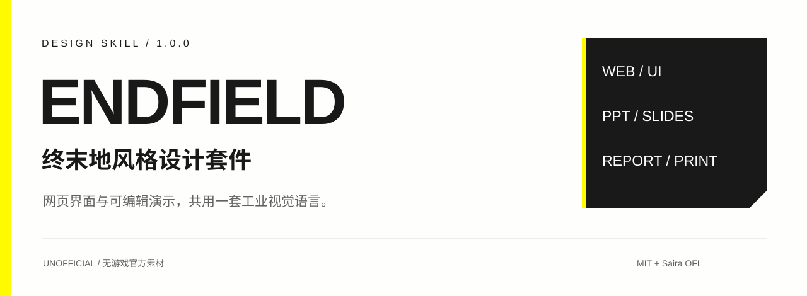
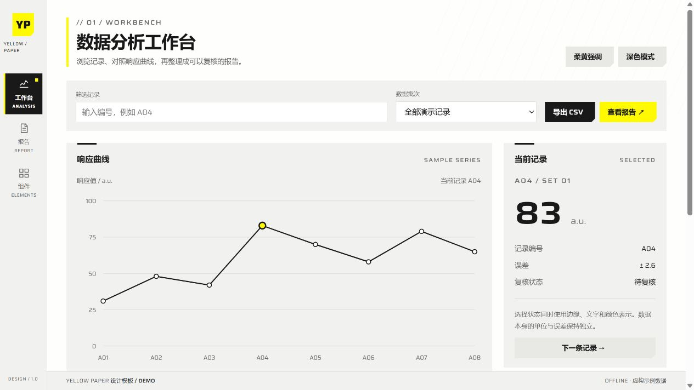
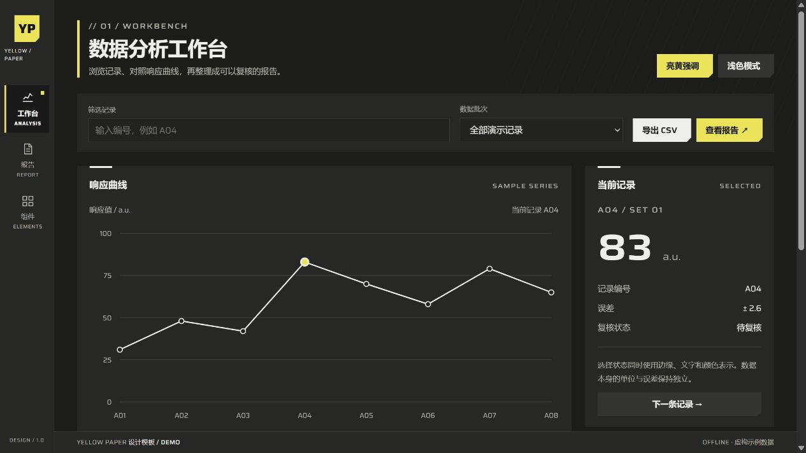
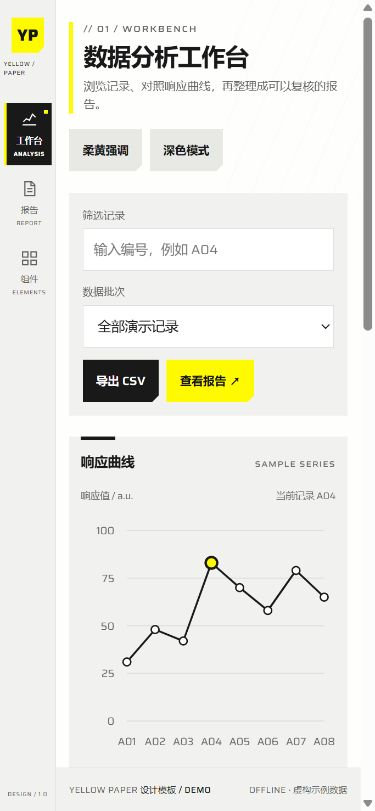
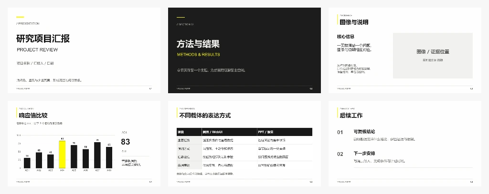

# Endfield Design Kit

**明日方舟：终末地风格的 AI 设计技能，用于网页、可编辑 PPT 和阅读报告。**

[English](README.en.md) · [技能入口](skills/endfield-design-kit/SKILL.md) · [PPT 模板](skills/endfield-design-kit/assets/slides/yellow-paper-template.pptx) · [来源与许可](NOTICE.md)



浅纸色、墨黑文字、亮黄强调、几何切角和清楚的中英文字体层级。默认提供 Yellow Paper 黄黑变体，并配有完整深色主题。

这是非官方的风格工具包，与游戏及其开发商无隶属或背书关系，不包含游戏官方素材。

## 能做什么

| 载体 | 提供的内容 |
| --- | --- |
| 网页 / WebUI | 离线字体、CSS 组件、响应式工作台；含筛选、记录选择、深浅色、CSV 导出和阅读视图 |
| PPT | 六类可编辑版式：封面、章节、图文、原生图表、原生表格和后续工作 |
| 报告 / 海报 | 同一套颜色、字体和信息层级的适配规则 |
| AI 技能 | 标准 `SKILL.md` 入口，按需加载网页、演示或其他载体的指导 |

技能负责视觉与交付方式。写业务功能、处理数据和制作最终文稿时，继续使用当前环境的相应工具。

## 看实际效果



<details>
<summary>深色与窄屏示例</summary>





</details>



克隆仓库后，可直接打开根目录的 `index.html` 查看产品展示，或打开 `skills/endfield-design-kit/assets/web/index.html` 使用完整网页示例。两者均不需要前端构建工具。

## 安装

### 用 skills CLI

安装到当前项目：

```sh
npx skills add zhendenanbeng/endfild-ui --skill endfield-design-kit
```

只给 Codex 安装，并在其他项目中复用：

```sh
npx skills add zhendenanbeng/endfild-ui --skill endfield-design-kit -a codex -g
```

需要可运行 [skills CLI](https://github.com/vercel-labs/skills) 的 Node.js。客户端安装和发现技能的行为以该工具的说明为准。

### 用 Python 安装

安装脚本只用 Python 标准库，不会覆盖已有技能：

```sh
git clone https://github.com/zhendenanbeng/endfild-ui.git
cd endfild-ui
python scripts/install.py
```

默认复制到 `~/.agents/skills/endfield-design-kit`。其他客户端可指定其技能目录：

```sh
python scripts/install.py --skills-dir /path/to/your/skills
```

### 手动复制

从仓库的 **Releases** 下载 `endfield-design-kit-版本号.zip`，将其中完整的 `endfield-design-kit` 文件夹放进客户端的技能目录。不要只复制 `SKILL.md`，模板与字体也需要一起保留。当前会话没有发现新技能时，重新开启会话。

## 调用示例

```text
使用 $endfield-design-kit 做一个终末地风格的数据分析前端。
保留观测筛选、数据表和导出，适配手机与桌面。
```

```text
使用 $endfield-design-kit 把这些材料做成 8 页可编辑 PPT。
保留原始数值、图例和引用，采用终末地风格。
```

```text
使用 $endfield-design-kit 为这份报告统一配色、标题和图表层级。
```

## 不使用 AI 也能起稿

在仓库目录运行：

```sh
python skills/endfield-design-kit/scripts/materialize.py --kind web --out ./dist/my-web
python skills/endfield-design-kit/scripts/materialize.py --kind slides --out ./dist/my-slides
```

网页输出可直接打开 `index.html`；演示输出是可编辑 PPTX。再次导出到同一位置会拒绝覆盖，避免丢失自己的修改。所有演示数值均为虚构数据，制作成品时应替换为自己的材料。

## 项目结构

```text
endfild-ui/
├── skills/endfield-design-kit/   可独立安装的技能与资源
├── index.html                   产品展示页
├── docs/                        展示样式、预览与发布说明
├── scripts/                     安装、检查和可重复打包
├── tests/                       安装、导出、PPT 与分发检查
└── .github/                     CI、Release 和问题模板
```

## 本地检查与发布

Python 3.10+：

```sh
python scripts/validate.py
python -m unittest discover -s tests -v
python scripts/build_release.py
python scripts/build_site.py
```

输出位于 `dist/`，包括技能 ZIP、静态展示站 ZIP 和 SHA-256 校验文件。安装后的技能不依赖仓库的开发脚本。

版本验证通过后，推送与 `project.json` 版本一致的 `v版本号` 标签即可触发 Release 工作流。维护方式见 [发布说明](docs/RELEASING.md) 与 [贡献指南](CONTRIBUTING.md)。

## 许可与致谢

原创代码和说明按 [MIT](LICENSE) 提供；Saira 字体按随包的 [SIL OFL 1.1](skills/endfield-design-kit/assets/web/fonts/Saira-OFL.txt) 单独许可。PPT 引用系统字体名称，不捆绑微软字体文件。

视觉方向参考 [hhikr/endfield-ui-skill](https://github.com/hhikr/endfield-ui-skill) 与经授权的界面原型，详细归属见 [NOTICE](NOTICE.md)。本项目面向网页与演示的共同工作流，没有捆绑原软件的核心算法、业务数据或私人配置。
